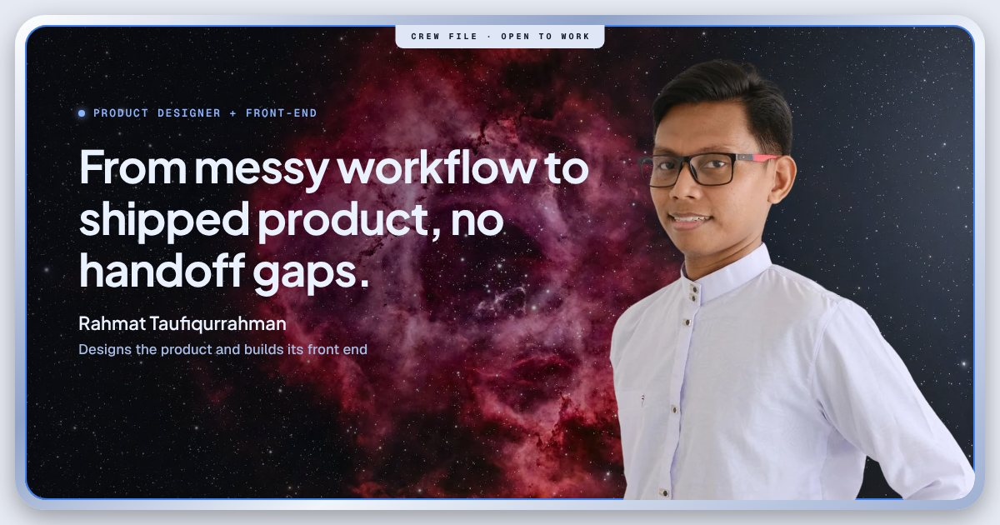

# Taufiq's portfolio



Live at **[taufiqwork.com](https://taufiqwork.com)**. This is the source of my product design portfolio: a home page, an about page, and two case studies.

| Page | What it is |
| --- | --- |
| [Home](https://taufiqwork.com) | Entry point with the project cards and latest log |
| [About](https://taufiqwork.com/about) | Who I am, how I work, contact links, resume download |
| [Tasmi'](https://taufiqwork.com/tasmi) | Case study: a registration and progress-tracking web app for a recitation program, in production |
| [Solide](https://taufiqwork.com/solide) | Case study: a desktop design tool that puts layout, vector drawing and motion in one canvas |

## About me

I'm Rahmat Taufiqurrahman, a product designer who also builds the front end. I frame the problem, design the flows and the UI system, then ship the code.

- Portfolio: [taufiqwork.com](https://taufiqwork.com)
- LinkedIn: [linkedin.com/in/taufiqurrahman05](https://www.linkedin.com/in/taufiqurrahman05)
- Email: hello.taufiq.design@gmail.com

## How it's built

- Static HTML, CSS and JavaScript. No framework build step and nothing to install.
- Fonts (Geist, Geist Mono, Plus Jakarta Sans, Inter, Manrope, DM Serif Display), React and icons are self-hosted, so the pages make no third-party requests.
- Responsive layout with three modes: sidebar (1280px and up), rail (1024 to 1279px) and bottom dock (below 1024px).
- Custom cursor on devices with a mouse, switched off on touch screens and for reduced-motion users.
- Per-page titles, descriptions, canonical URLs and Open Graph tags, plus `sitemap.xml` and `robots.txt`.
- Resume button appears on the About page only when `resume.pdf` exists in the repo root.

## Structure

```
index.html, about.html, solide.html, tasmi.html   pages (clean URLs: /about, /solide, /tasmi)
*.dc.html                                         embedded components used by the pages
support.js, site.js, cursor.js                    runtime, link handling, custom cursor
assets/, fonts/, vendor/                          images, self-hosted fonts, React and icon bundles
_headers                                          security and cache headers
resume.pdf                                        downloadable resume
```

## Run locally

```bash
python3 -m http.server 8000
# open http://localhost:8000
```

Any static file server works. Clean URLs such as `/about` need a server that maps them to `about.html`, which Cloudflare does by default.

## Deploy

The repo is connected to Cloudflare (Workers static assets). Every push to `main` builds and deploys automatically to `taufiqwork.com`.

## License

Design, copy and images are © Rahmat Taufiqurrahman, all rights reserved. Please don't reuse them without asking.
